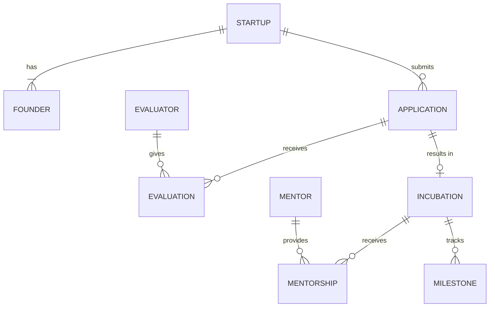

# Startup Incubation and Startup Management System

A database-driven web application for an incubation centre: startups register and apply,
evaluators score applications, accepted startups are admitted into incubation, mentors are
assigned, and progress is tracked through milestones.

Built for a **Database Systems (DBS)** course project with **PostgreSQL**, **Python**,
**psycopg** and **Streamlit**. All SQL is written by hand (no ORM).

---

## Features

**Five functional modules**

| # | Module | What it does |
|---|---|---|
| 1 | Startup Management | Register startups with founders, search/filter, update, delete (only if no application history) |
| 2 | Application Management | Submit applications, move them through *Submitted → Under Review → Accepted / Rejected*, admit to incubation (transaction) |
| 3 | Evaluation Management | Maintain evaluators, record a 0–100 score and feedback, view results (avg / min / max) |
| 4 | Mentor Management | Maintain mentors, assign them to incubated startups, keep mentorship remarks |
| 5 | Progress Management | Create milestones, update status, progress %, overdue milestones, dashboard |

**Four role views** (chosen from a "View as" selector in the sidebar; this is a UI feature, not login)

- **Administrator**: everything
- **Startup / Founder**: own profile, applications, feedback and progress
- **Evaluator**: applications still waiting for their score, and their past evaluations
- **Mentor**: the startups they mentor and those startups' milestones

## Database design

Nine relations, mapped from an ER model and in **BCNF** (hence 3NF):



Integrity is enforced **inside the database**:

- primary keys (surrogate identity keys; composite keys for `evaluation` and `mentorship`)
- foreign keys with deliberate `ON DELETE CASCADE / RESTRICT` rules
- `NOT NULL`, `UNIQUE` and named `CHECK` constraints (including "if and only if" checks such as
  *completion date exists ⇔ status is Completed*)
- a **partial unique index** so a startup has at most one open application
- **transactions** for multi-step operations (register startup + first founder; accept
  application + create incubation)

SQL concepts used in the 21 report queries and 2 views: joins, `LEFT JOIN … IS NULL`,
aggregates, `GROUP BY` / `HAVING`, subqueries, correlated subqueries, `EXISTS` / `NOT EXISTS`,
`CASE`, date arithmetic and views.

## Tech stack

| Component | Version |
|---|---|
| PostgreSQL | 18 |
| Python | 3.14 |
| psycopg | 3.3.8 |
| Streamlit | 1.67.0 |

## Project structure

```
├── app/
│   ├── app.py                  # entry point: role selector and tabs
│   ├── db.py                   # the only file that talks to PostgreSQL
│   ├── startup_module.py       # Module 1
│   ├── application_module.py   # Module 2 (admission transaction)
│   ├── evaluation_module.py    # Module 3
│   ├── mentor_module.py        # Module 4
│   └── progress_module.py      # Module 5
├── sql/
│   ├── 01_schema.sql           # 9 tables, constraints, partial unique index
│   ├── 02_sample_data.sql      # realistic sample data (one transaction)
│   ├── 03_constraint_tests.sql # deliberately violates each constraint (rolled back)
│   ├── 04_queries.sql          # report queries Q1–Q19
│   └── 05_views.sql            # 2 views + queries Q20–Q21
├── tests/
│   └── test_app.py             # 56 automated test cases
├── docs/                       # requirements, ER design, normalization, testing notes
├── results/                    # saved outputs of the tests and queries
├── report/                     # LaTeX project report (main.tex, chapters/, figures/)
├── .env.example                # template for database settings
└── requirements.txt
```

## Setup and running

### 1. Prerequisites
- [PostgreSQL](https://www.postgresql.org/download/) (with `psql` on your PATH)
- [Python 3.10+](https://www.python.org/downloads/)

### 2. Get the code and install packages
```bash
git clone https://github.com/madhuumithrann/startup-management-system.git
cd startup-management-system
python -m venv .venv
.venv\Scripts\activate          # Windows
# source .venv/bin/activate     # macOS / Linux
pip install -r requirements.txt
```

### 3. Configure the database connection
Copy the template and put **your own** PostgreSQL password in it:
```bash
copy .env.example .env          # Windows
# cp .env.example .env          # macOS / Linux
```
`.env` is ignored by git, so the password never ends up in the repository.

### 4. Create the database and load the data
```bash
psql -U postgres -c "CREATE DATABASE incubation_db;"
psql -U postgres -d incubation_db -f sql/01_schema.sql
psql -U postgres -d incubation_db -f sql/02_sample_data.sql
psql -U postgres -d incubation_db -f sql/05_views.sql
```
Optional: `sql/03_constraint_tests.sql` (shows every constraint rejecting bad data) and
`sql/04_queries.sql` (runs the report queries).

### 5. Run the app
```bash
streamlit run app/app.py
```
It opens at <http://localhost:8501>.

## Testing

```bash
python tests/test_app.py
```
Runs 56 test cases covering every module, constraint, transaction and role screen. It reloads
the sample data before each group and again at the end, and writes the results to
`results/test_results.md`. Current result: **56 / 56 passed**.

## Documentation

| File | Contents |
|---|---|
| [docs/01_requirements.md](docs/01_requirements.md) | Functional requirements, business rules, reports |
| [docs/02a_entities_and_er.md](docs/02a_entities_and_er.md) | Entities, attributes, keys, relationships, ER diagram |
| [docs/02b_schema_and_normalization.md](docs/02b_schema_and_normalization.md) | Relational schema, FDs, UNF → BCNF, constraints |
| [docs/05_testing.md](docs/05_testing.md) | Test plan and results |
