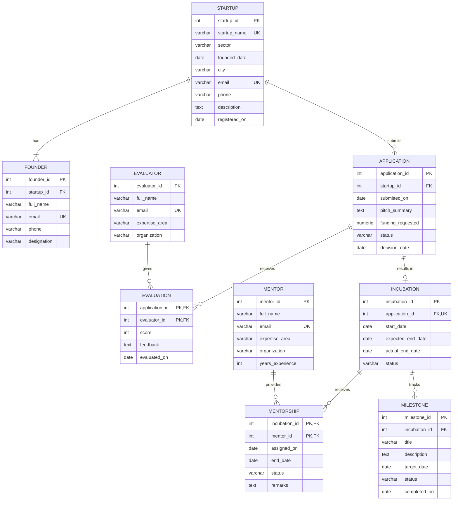

# Phase 2A — Entities, Attributes, Keys, Relationships and ER Diagram
## Startup Incubation and Startup Management System

*Builds on: [01_requirements.md](01_requirements.md) · Next: 02b (schema, FDs, normalization)*

---

## 1. Design choices that apply to every table

**1.1 Surrogate primary keys.** Each main entity gets an auto-generated integer ID (`startup_id`, `mentor_id`, …).
- *Why not use `startup_name` or `email` as the PK?* Both are **candidate keys** (unique), but they can **change**: a startup gets renamed, a founder changes email. If a natural key were the PK, every foreign key pointing to it would need updating too. An integer ID never changes, is small, and makes joins fast.
- We still declare the natural candidate keys `UNIQUE`, so duplicates remain impossible.

**1.2 Composite primary keys for relationship tables.** `Evaluation` and `Mentorship` represent many-to-many relationships. Their natural identity is the *pair* of IDs they connect, so we use that pair as the PK. Besides being correct, this gives us a real composite key to analyse for **partial dependencies** in 2NF (Phase 2B).

**1.3 Status columns use a fixed list of values**, enforced by a CHECK constraint (e.g., `status IN ('Pending','In Progress','Completed')`). This is **domain integrity**. A separate lookup table is an alternative, discussed in 2B.

**1.4 Notation:** **PK** = primary key, **FK** = foreign key, **UQ** = unique (candidate key), **NN** = NOT NULL.

---

## 2. Entities and attributes

### 2.1 STARTUP — a company registered with the centre (Module 1)
| Attribute | Type (PostgreSQL) | Key / rule | Why it exists |
|---|---|---|---|
| startup_id | INT, auto | **PK** | Stable identifier |
| startup_name | VARCHAR(100) | UQ, NN | No two startups with the same name (BR-2) |
| sector | VARCHAR(50) | NN, CHECK in list | Needed for report R1 (startups per sector) |
| founded_date | DATE | NN, ≤ today | Shows the startup's age |
| city | VARCHAR(50) | NN | Basic profile info |
| email | VARCHAR(100) | UQ, NN | Official contact (BR-2) |
| phone | VARCHAR(15) | — | Optional contact |
| description | TEXT | — | What the startup does |
| registered_on | DATE | NN, DEFAULT today | When it registered with the centre |

Candidate keys: `{startup_id}`, `{startup_name}`, `{email}`.

### 2.2 FOUNDER — a person who founded a startup (Module 1)
| Attribute | Type | Key / rule | Why |
|---|---|---|---|
| founder_id | INT, auto | **PK** | Identifier |
| startup_id | INT | **FK → Startup**, NN | Which startup they belong to (D1: exactly one) |
| full_name | VARCHAR(100) | NN | |
| email | VARCHAR(100) | UQ, NN | Identifies the person |
| phone | VARCHAR(15) | — | |
| designation | VARCHAR(50) | NN | e.g., CEO, CTO, Co-founder |

*Why a separate table instead of `founder1`, `founder2` columns in Startup?* A startup can have any number of founders. Repeating columns would break **1NF** (a repeating group) and waste NULLs.

### 2.3 APPLICATION — a request for incubation (Module 2)
| Attribute | Type | Key / rule | Why |
|---|---|---|---|
| application_id | INT, auto | **PK** | |
| startup_id | INT | **FK → Startup**, NN | Who applied |
| submitted_on | DATE | NN, DEFAULT today | |
| pitch_summary | TEXT | NN | What the evaluators read |
| funding_requested | NUMERIC(12,2) | NN, ≥ 0 | Gives meaningful SUM/AVG reports |
| status | VARCHAR(20) | NN, DEFAULT 'Submitted', CHECK in {Submitted, Under Review, Accepted, Rejected} | Tracks the lifecycle (BR-4) |
| decision_date | DATE | NULL until decided; ≥ submitted_on | When it was accepted or rejected |

*Why is Application separate from Startup?* Under D2 a startup may apply **several times**. Each attempt has its own date, pitch and status. That is a 1:N relationship, so it needs its own table.

### 2.4 EVALUATOR — an expert who scores applications (Module 3)
| Attribute | Type | Key / rule |
|---|---|---|
| evaluator_id | INT, auto | **PK** |
| full_name | VARCHAR(100) | NN |
| email | VARCHAR(100) | UQ, NN |
| expertise_area | VARCHAR(50) | NN |
| organization | VARCHAR(100) | — |

### 2.5 EVALUATION — one evaluator's score for one application (Module 3)
| Attribute | Type | Key / rule | Why |
|---|---|---|---|
| application_id | INT | **PK (part 1)**, FK → Application | Which application |
| evaluator_id | INT | **PK (part 2)**, FK → Evaluator | Who scored it |
| score | INT | NN, CHECK 0–100 | D3, BR-6 |
| feedback | TEXT | NN | D3 |
| evaluated_on | DATE | NN, DEFAULT today | |

*Why is the PK `(application_id, evaluator_id)`?* BR-5 says each evaluator evaluates a given application **at most once**. Making the pair the PK enforces that rule automatically: a second row with the same pair is rejected.

*Why is Evaluation an entity and not just a relationship?* It is an M:N relationship between Application and Evaluator that **has its own attributes** (score, feedback, date). In ER terms it is a relationship with attributes; in the relational schema it becomes its own table either way.

### 2.6 INCUBATION — an admitted startup's stay in the programme (Modules 4 & 5)
| Attribute | Type | Key / rule | Why |
|---|---|---|---|
| incubation_id | INT, auto | **PK** | |
| application_id | INT | **FK → Application**, **UQ**, NN | The accepted application that led to admission |
| start_date | DATE | NN | |
| expected_end_date | DATE | NN, > start_date | BR-11 |
| actual_end_date | DATE | NULL while active | |
| status | VARCHAR(20) | NN, DEFAULT 'Active', CHECK in {Active, Graduated, Exited} | |

*Why does this table exist at all? Couldn't we add `start_date` etc. to Application?*
1. These attributes apply **only to accepted applications**. In Application they would be NULL for every rejected or pending row. That is wasteful, and it muddles what an Application row means.
2. Under D4, mentorships and milestones must attach to an **admitted** startup. Incubation is that "admitted startup" object. Because Mentorship and Milestone have foreign keys to Incubation, the database itself makes it impossible to mentor a startup that was never admitted (BR-8).

*Why does it reference `application_id` and not `startup_id`?* The startup is reachable through the application (Incubation → Application → Startup). Storing `startup_id` here as well would be **redundant**: it is determined by `application_id`, which is a transitive dependency. Phase 2B shows this formally.

*Why is `application_id` UNIQUE?* One accepted application leads to **at most one** incubation. The UNIQUE constraint on the FK is what turns a 1:N relationship into a **1:1** relationship.

### 2.7 MENTOR — an expert who guides incubated startups (Module 4)
| Attribute | Type | Key / rule |
|---|---|---|
| mentor_id | INT, auto | **PK** |
| full_name | VARCHAR(100) | NN |
| email | VARCHAR(100) | UQ, NN |
| expertise_area | VARCHAR(50) | NN |
| organization | VARCHAR(100) | — |
| years_experience | INT | NN, ≥ 0 |

*Why not merge Evaluator and Mentor into one "Expert" table?* They play different roles with different relationships and attributes (e.g., `years_experience` only matters for mentors). Merging them would need a `role` column plus rules like "only experts with role = Mentor may appear in Mentorship", and those are hard to enforce with simple constraints. Keeping them separate is simpler and clearer. (The merged design is an example of **generalization/specialization**, a good point to mention in the viva.)

### 2.8 MENTORSHIP — a mentor assigned to an incubated startup (Module 4)
| Attribute | Type | Key / rule | Why |
|---|---|---|---|
| incubation_id | INT | **PK (part 1)**, FK → Incubation | Who is mentored (D4) |
| mentor_id | INT | **PK (part 2)**, FK → Mentor | Who mentors |
| assigned_on | DATE | NN, DEFAULT today | |
| end_date | DATE | NULL while ongoing; ≥ assigned_on | |
| status | VARCHAR(20) | NN, DEFAULT 'Active', CHECK in {Active, Completed} | |
| remarks | TEXT | — | Mentor's notes (Mentor view) |

### 2.9 MILESTONE — a progress target for an incubated startup (Module 5)
| Attribute | Type | Key / rule | Why |
|---|---|---|---|
| milestone_id | INT, auto | **PK** | |
| incubation_id | INT | **FK → Incubation**, NN | D4 |
| title | VARCHAR(100) | NN; UQ together with incubation_id | No duplicate milestone titles for the same startup |
| description | TEXT | — | |
| target_date | DATE | NN | Needed to detect overdue milestones (R9) |
| status | VARCHAR(20) | NN, DEFAULT 'Pending', CHECK in {Pending, In Progress, Completed} | |
| completed_on | DATE | NOT NULL **iff** status = 'Completed' | BR-10 |

*Note:* a milestone cannot exist without its incubation (**existence dependency**). In 2B we'll set `ON DELETE CASCADE` for this FK.

---

## 3. Final entity list: all 9 candidates kept

| Entity | Kept? | Reason |
|---|---|---|
| Startup | ✔ | Core entity |
| Founder | ✔ | Multi-valued "founders" of a startup → separate table (1NF) |
| Application | ✔ | A startup can apply many times (D2) |
| Evaluator | ✔ | Independent people with their own data |
| Evaluation | ✔ | M:N relationship with attributes |
| Incubation | ✔ | Represents "admitted"; anchor for D4 |
| Mentor | ✔ | Independent people with their own data |
| Mentorship | ✔ | M:N relationship with attributes |
| Milestone | ✔ | 1:N progress records per incubation |

No extra tables were added.

---

## 4. Relationships and cardinalities

| # | Relationship | Cardinality | Participation | Implemented by |
|---|---|---|---|---|
| R1 | Startup **has** Founder | 1 : N | Founder total (must belong to a startup); Startup should have ≥ 1 founder (checked by the app) | `founder.startup_id` FK, NOT NULL |
| R2 | Startup **submits** Application | 1 : N | Application total; Startup partial (may not have applied yet) | `application.startup_id` FK, NOT NULL |
| R3 | Evaluator **evaluates** Application | M : N (with attributes) | Both partial | Table `evaluation`, PK (application_id, evaluator_id) |
| R4 | Application **results in** Incubation | 1 : 1 | Incubation total; Application partial (only accepted ones) | `incubation.application_id` FK, NOT NULL + UNIQUE |
| R5 | Mentor **mentors** Incubation | M : N (with attributes) | Both partial | Table `mentorship`, PK (incubation_id, mentor_id) |
| R6 | Incubation **has** Milestone | 1 : N | Milestone total; Incubation partial | `milestone.incubation_id` FK, NOT NULL |

**How to read the participation column:** "total" means every row of that entity must take part in the relationship. In SQL we get that by making the foreign key **NOT NULL**. "Partial" means taking part is optional.

---

## 5. ER diagram (crow's-foot, Mermaid)

A Chen-notation version (rectangles, diamonds, ovals) will be drawn in TikZ for the LaTeX report. This version is for checking the design now.

**Reading the crow's-foot symbols:** `||` = exactly one, `o|` = zero or one, `|{` = one or more, `o{` = zero or more. For example, `APPLICATION ||--o| INCUBATION` reads: "each incubation comes from exactly one application; each application leads to zero or one incubation."

---

## 6. How the role views (D5) use this design — no extra tables needed

| Role | Filter applied | Example query idea |
|---|---|---|
| Startup | `startup_id = chosen startup` | Its applications, evaluation feedback, milestones |
| Evaluator | `evaluator_id = chosen evaluator` | Applications Under Review **for which no evaluation by this evaluator exists** (NOT EXISTS, a correlated subquery) |
| Mentor | `mentor_id = chosen mentor` | Incubations where an Active mentorship row exists → their milestones |
| Admin | none | Everything |

---

## 7. Open points for 2B
- Constraints that *cannot* be expressed as a simple column CHECK: "only one open application per startup" (BR-3), "an incubation's application must be Accepted" (BR-7), "a startup must have ≥ 1 founder" (BR-1). We'll decide between a partial unique index, application logic and a transaction.
- ON DELETE behaviour for every foreign key (BR-9).
- The sector list for the CHECK constraint (proposal: FinTech, HealthTech, EdTech, AgriTech, CleanTech, E-Commerce, SaaS, Other).
